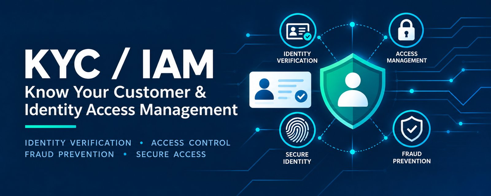

# KYC / AML Simulator

**Live demo:** https://cybersecinfo.com/kyc/

A browser based simulator of a regulated firm's customer onboarding controls: **customer due diligence (CDD), sanctions and PEP screening, risk based scoring, enhanced due diligence (EDD), case management with an audit trail, and KYC/AML metrics.**

Every rule in the engine is mapped to a written policy ([docs/POLICY.md](docs/POLICY.md)) and to the Irish **Criminal Justice (Money Laundering and Terrorist Financing) Act 2010**, which transposes the EU AML Directives, with notes on the new EU single rulebook (**Regulation (EU) 2024/1624, AMLR**) that applies from 10 July 2027.

> Educational portfolio project. All sanctions and PEP entries shipped with the app are **fictional**. Do not enter real personal data.

## What it does

| Area | Feature | Legal basis |
|---|---|---|
| Onboarding | Individual, sole trader, company and trust customers, with beneficial owner (UBO) capture and a live risk preview | CJA 2010 s.33, s.35 |
| Screening | Fuzzy name matching (Jaro Winkler, token sorting, alias matching, legal suffix removal) against sanctions and PEP lists for the customer and every UBO. Date of birth used to downgrade conflicting matches | EU sanctions regulations, s.37 |
| Risk scoring | Points based customer risk score from customer type, geography, sector, PEP status, ownership transparency, expected volume, source of funds and adverse media. Low, Medium and High tiers | s.30A, s.30B |
| Proof of address | Document type and date for individuals and sole traders. Missing, undated, future dated or older than 6 months makes CDD incomplete, and it is re-checked at every review | s.33, Central Bank guidelines |
| Red flags | 11 indicators in four groups (documents, behaviour, funds, structure). Each adds risk points, must be explained before approval, and removes approval from the analyst: only a senior analyst or the MLRO can approve | s.39, Sch. 4, s.42 |
| Information requests | Draft message to the customer listing the outstanding items. It never mentions screening, red flags or the MLRO | s.33, s.49 |
| Due diligence | CDD completeness checks (identity verification, expired ID, missing UBO). Mandatory EDD for PEPs and EU high risk third countries, with senior management approval | s.33, s.34A, s.37, s.38A, s.39 |
| Decisions | Policy enforced decisions (approve, reject, request information, escalate to MLRO). A named analyst and a written rationale are always required. Strong sanctions matches cannot be cleared by the analyst | s.42, s.49 |
| Access control (IAM) | RBAC combined with attribute based rules (ABAC): Analyst, Senior analyst, MLRO and read only Internal auditor. Least privilege, segregation of duties, four eyes approval, delegated authority granted by the MLRO, permission matrix and access log | s.54, s.37, s.38A |
| Business verification | ID document type and the official register for companies and sole traders: CRO and RBO (Ireland), Certidão Permanente (Portugal), CNPJ (Brazil) | s.33 |
| Ongoing CDD | Periodic reviews by risk tier (12, 24, 36 months) with overdue and due soon queues, event driven reviews (ownership, activity, country, expired ID, adverse media, PEP, list update), data updates logged before and after, re-screening and a new decision | s.33, s.35(3) |
| Exceptions | Register of documented policy deviations with a mitigation and a deadline of at most 90 days, four eyes approval, overdue tracking and closure notes. Never unlocks a blocked case | s.54 |
| Quality assurance | Risk based sample (all High risk, 1 in 4 of the rest), 6 point checklist by an independent senior reviewer, pass rate by analyst and error trends | s.54, Central Bank guidelines |
| Audit | Append only audit trail on every case and periodic review date by risk tier | s.55 |
| Metrics | Cases by status and tier, EDD rate, escalation rate, false positive rate, average time to decision, reviews overdue, open exceptions, QA pass rate, ageing and SLA breaches, CSV export | Central Bank of Ireland guidelines |
| Watchlists | Import the EU consolidated financial sanctions list (CSV), toggle high risk third countries | Delegated Regulation (EU) 2016/1675 |

## Screenshots

Load the demo cases from the dashboard, then switch users in the header to see 22 realistic cases, including a sanctions match on a name variant, a cleared false positive, a confirmed PEP approved after EDD, a company with no disclosed beneficial owner and a high risk third country escalation. Payments and e-commerce sellers from Portugal and Brazil, with case notes in Portuguese, show a customer whose funds do not match his payslips and come from a third party (red flags), a proof of address that is too old, an overdue periodic review, an event driven review after an expired Cartão de Cidadão, a volume spike under review, a CNPJ that does not match the articles, exceptions awaiting four eyes approval and a failed QA check.

## Run it

No build tools or server are needed.

```bash
# open the app
open index.html            # macOS
start index.html           # Windows

# run the unit tests (Node.js)
node tests/engine.test.js

# build a single self contained file in dist/index.html
node build.js
```

## Project structure

```
index.html            UI layout and styles
src/engine.js         Rules engine: matching, risk scoring, decisions, metrics (no DOM, unit tested)
src/app.js            UI logic, case lifecycle, demo data, browser storage
tests/engine.test.js  43 unit tests covering matching, CDD, proof of address, red flags, information requests, EDD, decisions, access control, reviews, exceptions, QA, CSV import and metrics
docs/POLICY.md        KYC and AML policy mapping every rule to the law
build.js              Inlines the scripts into dist/index.html
```

## Design decisions

* **Human in the loop.** The engine only recommends. Every approval or rejection needs a named analyst and a rationale, in line with the expectation of meaningful human oversight of onboarding decisions.
* **Explainability.** Each risk factor shows its points and its legal reference, so any decision can be traced back to the law.
* **Fail closed.** Incomplete CDD, unreviewed screening hits and strong sanctions matches disable the approve button instead of relying on the analyst to notice.
* **Security by design.** Permissions are checked by the rules engine on every action, not just by hiding buttons. Use the "Signed in as" switcher to see how the same case looks to an analyst, a senior analyst, the MLRO and an internal auditor.
* **No tipping off.** Escalation to the MLRO is an internal action only and never produces customer facing text.
* **Privacy by design.** Data stays in the browser. No server, no tracking, no real personal data in the sample lists.

## Limitations

* Sample sanctions and PEP data are fictional. Real screening requires the current official lists and transliteration support.
* The high risk third country list is an illustrative subset and must be checked against the current Delegated Regulation.
* Identity verification is simulated. Real onboarding uses document and electronic verification providers.
* Risk weights are illustrative and would be calibrated from a firm's business wide risk assessment.

## Author

**Adriano Huttener**, MSc Cybersecurity candidate, National College of Ireland.
Portfolio: [cybersecinfo.com/portfolio](https://cybersecinfo.com/portfolio) · GitHub: [github.com/ahuttener](https://github.com/ahuttener)

Not legal advice.
